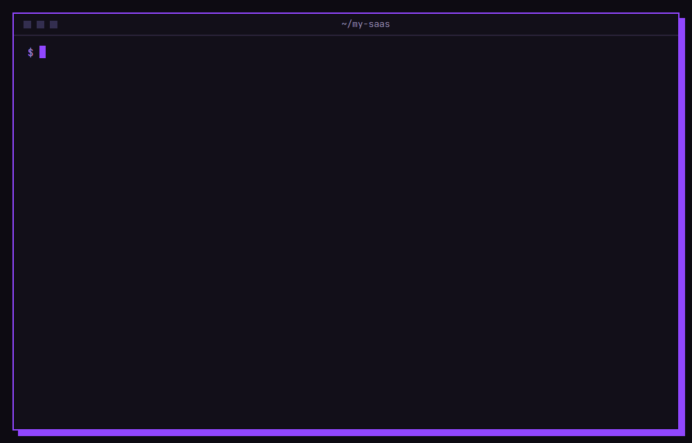

# stillworks

**Your AI writes the code. This checks it still works.**

[](https://www.npmjs.com/package/stillworks)
[](LICENSE)
[](https://github.com/valmirjunior2109-spec/stillworks/actions/workflows/ci.yml)

Claude Code, Cursor and Codex write code fast. The code compiles, passes lint and tests, and signup is still broken, often in a file the agent wasn't supposed to touch.

`stillworks` runs the journeys your users actually click through (signup, login, checkout) in a real browser. When one breaks, it writes a report your coding agent can act on: the step that failed, the console errors, the failed requests with the server's response, and a screenshot.

<p align="center">
  
</p>
<!-- To re-record the GIF, see assets/RECORDING.md -->

## Quickstart (30 seconds)

```sh
npx stillworks init                              # creates journeys.config.ts and installs Chromium
# edit the selectors in journeys.config.ts so they match your app
npx stillworks run --url http://localhost:3000   # runs every journey in a real browser
```

It exits with code `1` when a journey breaks. Open `verify-report/REPORT.md` and paste it into your agent.

Works on macOS, Linux and Windows with Node.js 20 or newer.

## What your agent gets

Here's the real report from [the demo app](examples/demo-app/server.mjs). Its signup API was "refactored" to read `emailAddress` while the form still sends `email`. TypeScript can't see it, the unit tests pass, and the user sees a button that does nothing.

````markdown
## The `signup` journey failed at step 4 of 4: "See the welcome screen"

Steps that passed before it: 1. Open the signup page · 2. Fill in email and password · 3. Submit the form

Error:

```
locator.waitFor: Timeout 10000ms exceeded.
- waiting for getByText(/welcome/i).first() to be visible
```

Page URL when it failed: http://localhost:3000/signup

Console errors:

- Create your account failed: 500 {"error":"TypeError: Cannot read properties of undefined (reading 'toLowerCase')"} (at /signup:23)

Failed requests:

- POST /api/signup → 500 Internal Server Error
  Response: `{"error":"TypeError: Cannot read properties of undefined (reading 'toLowerCase')"}`

Screenshot: verify-report/screenshots/signup-04-see-the-welcome-screen.png

Fix this without changing unrelated files. Find the root cause (start from the failed requests and console errors above); don't change the journey or weaken the check to make it pass. These journeys still pass, keep them passing: `login`, `checkout`.

When you're done, run `npx stillworks run --url http://localhost:3000` and confirm every journey passes.
````

The full file is in [examples/REPORT.example.md](examples/REPORT.example.md). Every run also writes `verify-report/report.json` for scripts and a screenshot of every step.

## Writing journeys

A journey is a list of named steps. Each step is plain [Playwright](https://playwright.dev/docs/locators), so anything Playwright can do, a step can do.

```ts
// journeys.config.ts
import { defineConfig } from "stillworks";

export default defineConfig({
  baseURL: "http://localhost:3000", // --url overrides this
  journeys: [
    {
      name: "signup",
      steps: [
        { name: "Open the signup page", run: ({ page }) => page.goto("/signup") },
        {
          name: "Fill in email and password",
          run: async ({ page }) => {
            await page.getByLabel("Email").fill(`test+${Date.now()}@example.com`);
            await page.getByLabel("Password").fill("correct-horse-battery-staple");
          },
        },
        { name: "Submit the form", run: ({ page }) => page.getByRole("button", { name: "Create account" }).click() },
        { name: "See the welcome screen", run: ({ page }) => page.getByText("Welcome").waitFor() },
      ],
    },
  ],
});
```

Tips:

- Name steps the way you'd describe them to a person. The names end up in the prompt your agent reads.
- Prefer `getByRole` and `getByLabel` over CSS selectors. They survive refactors, and they break when accessibility does.
- Every journey starts with fresh cookies. Use a test account for login and test mode for payments, never real ones.
- Ask your agent to write them: *"Read journeys.config.ts and add a journey for inviting a teammate."*

| Option | Default | What it does |
| --- | --- | --- |
| `baseURL` | — | The app to check. `--url` and `STILLWORKS_URL` override it. |
| `timeout` | `10000` | Max time for each action or wait, in ms. |
| `failOnConsoleErrors` | `false` | Fail a journey when the page logs an error, even if every step passed. |
| `ignoreConsole` | `[]` | Console errors to ignore (strings or RegExps). |
| `ignoreRequests` | `[]` | Request URLs to leave out of "failed requests". |
| `headers` | `{}` | Headers sent only to your app's origin, e.g. a preview protection bypass. |
| `viewport` | `1280×800` | Browser size. |

## Use it with your agent

**Claude Code**
- `npx stillworks init --claude` adds a `/verify` command: Claude runs the journeys, reads the report, fixes the bug and runs them again.
- To check automatically every time Claude finishes, add the [Stop hook](integrations/claude-code/README.md). It skips turns where no file changed and never blocks Claude when the app isn't running.

**Cursor:** `npx stillworks init --cursor` adds a [rule](integrations/cursor/rules/stillworks.mdc) that tells the agent to verify after every change.

**Codex, GitHub Copilot, Windsurf:** paste [this section](integrations/agents-md/AGENTS.md) into your `AGENTS.md`.

**GitHub Actions + Vercel previews:** `npx stillworks init --github` adds a [workflow](integrations/github-actions/stillworks.yml). It runs your journeys against every successful preview deploy and puts the report in the run summary. Deployment Protection is supported.

## Want this automatic on every change?

`stillworks` runs your journeys and writes the report on your machine, when you ask. That part is free and open source, for good.

**[Publishub](https://getpublishub.com/?utm_source=gh_readme)** is building the version that runs by itself. It's coming soon, and nothing below is available yet:

| | stillworks (open source) | Publishub (coming soon) |
| --- | --- | --- |
| Run journeys in a real browser | ✅ | planned |
| Screenshots, console errors, failed requests | ✅ | planned |
| Report written as a prompt for your agent | ✅ | planned |
| Runs on your machine and in your CI | ✅ | — |
| Compares with your last working version (regression diffs) | — | planned |
| History of every run | — | planned |
| Hosted runs on every change and every PR | — | planned |
| Bug reports sent straight to your agent | — | planned |

Two ways in:

- **[Join the free waitlist →](https://getpublishub.com/?utm_source=gh_readme#early-access)** Product updates and an email when it launches. No payment.
- **[Become a Founding Customer →](https://getpublishub.com/?utm_source=gh_founding#pricing)** $0 today, then $19/month only once Publishub launches. You lock in the founding price, get early and priority access, and help decide what Publishub checks. You get at least 7 days' notice before the first charge, you can cancel any time before it, and the first payment is refundable within 14 days.

## CLI

```
npx stillworks init [--claude] [--cursor] [--github] [--skip-install] [--force]
npx stillworks run [--url <url>] [--config <file>] [--out <dir>] [--journey <name>]...
                   [--header "name: value"]... [--timeout <ms>] [--channel chrome|msedge]
                   [--headed] [--no-promo]
npx stillworks install [--with-deps]
npx stillworks hook claude-code
```

- **Exit codes:** `0` every journey passed · `1` a journey failed · `2` setup problem (no config, app not reachable, unknown journey).
- **`--channel`** uses a Chrome or Edge you already have instead of downloading Chromium.
- **`--header`** sends a header to your app's origin only, never to third parties. Use it for things like `x-vercel-protection-bypass`.

### Privacy and the one promo line

- **No telemetry.** `stillworks` collects nothing and sends nothing anywhere. The only network requests it makes are to the URL you check. Chromium is downloaded by Playwright when you run `install`.
- At the end of `run`, it prints one line about Publishub: `Want this on every AI change, with regression diffs? → https://getpublishub.com/?utm_source=gh_cli`.
  - Turn it off with `--no-promo` or `NO_PUBLISHUB_PROMO=1`.
  - The Claude Code hook never prints it.
  - `REPORT.md` ends with a one-line footer linking to Publishub.

## Try it on the demo app

```sh
git clone https://github.com/valmirjunior2109-spec/stillworks && cd stillworks
npm install && npm run build && node dist/cli.js install
npm run demo:broken                                # in one terminal
node dist/cli.js run --url http://127.0.0.1:4173 --config templates/journeys.config.ts
```

Signup fails at step 4 and login and checkout pass. Stop the app, run `npm run demo` instead, and all three pass.

## Contributing

Bug reports, journey templates for common stacks (Next.js + Supabase auth, Clerk, Stripe Checkout…) and integrations for more agents are all welcome. See [CONTRIBUTING.md](CONTRIBUTING.md). Want a journey you don't know how to write? [Open a journey request](https://github.com/valmirjunior2109-spec/stillworks/issues/new?template=journey_request.yml).

## License

[MIT](LICENSE). Made by the team building [Publishub](https://getpublishub.com/?utm_source=gh_readme).
